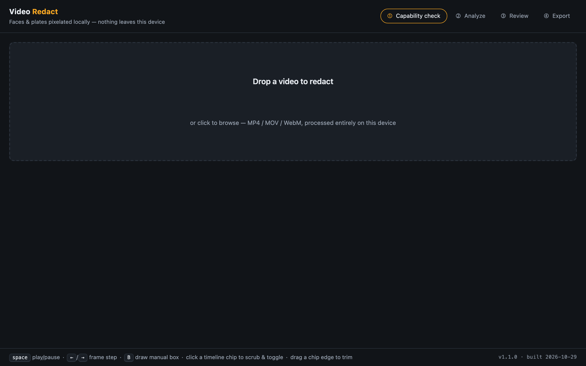
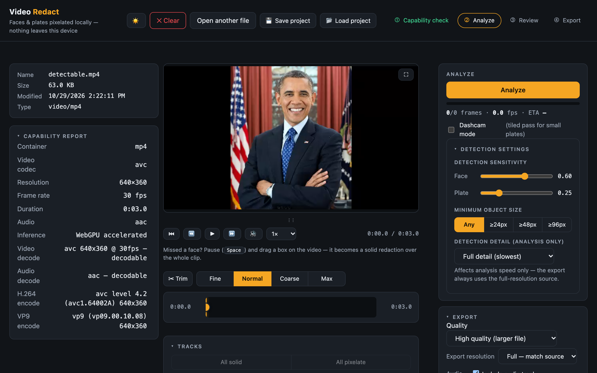
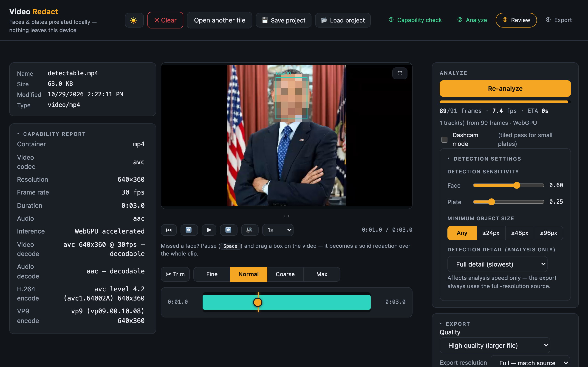
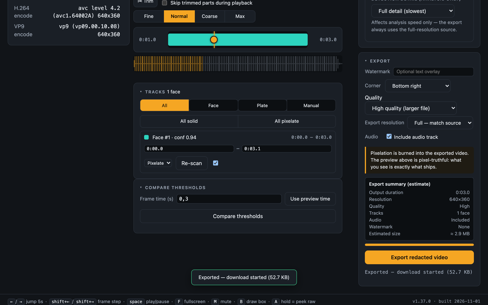

# Video Redact

Local, in-browser video redaction: faces and license plates are detected automatically, reviewed on a timeline, and pixelated **burned into the exported pixels** — nothing is ever uploaded. There is no server; the shipped artifact is a single self-contained `index.html`.

**Live app**: <https://cj-1981.github.io/video-redact/> (served over HTTPS, so it runs directly in the browser — every push to `main` rebuilds and redeploys it via GitHub Actions; the footer badge shows the version + build date).

| Landing | Capability report + Analyze panel |
| --- | --- |
|  |  |

| Review | Export |
| --- | --- |
|  |  |

1. **Landing** — drop a video; the four-step stepper (Capability check → Analyze → Review → Export) and the footer version badge (`v1.6.0 · built 2026-10-29`).
2. **Capability** — after opening a file, the app reports container/codec/resolution/fps/audio plus decode and encode probes *before* Analyze is offered. Undecodable files are blocked here, with guidance. The Analyze panel carries the detection-sensitivity sliders and a single-frame "Compare thresholds" preview.
3. **Review** — detected tracks render as colored chips over their redacted span; the preview is pixel-truthful (it draws the exact redaction the export burns in). Toggle any track, switch its style (pixelate/solid), trim its span, scrub with the transport bar, or draw manual regions (`B`).
4. **Export** — re-encoded H.264/MP4 (VP9/WebM fallback) with redactions burned in; original audio is packet-copied bit-for-bit.

## Quick start

Requires Node >= 20 and a Chromium-based browser.

```sh
npm install
npm run build        # bundles src/ into the single-file dist/index.html
npm run dev          # serves the repo root at http://127.0.0.1:8000
```

Then open <http://localhost:8000/dist/index.html>. Or skip the local setup entirely and use the hosted page: <https://cj-1981.github.io/video-redact/>.

**Serve over localhost — never `file://`.** The app needs secure-context APIs (WebCodecs, IndexedDB, OPFS, WASM); under `file://` it deliberately blocks all processing and shows serve instructions (`python3 -m http.server 8000`, `npx serve`). `python3 -m http.server 8000` or `npx serve` from the repo root work just as well — and the GitHub Pages deployment is already HTTPS, so it is a secure context by default.

## What it does

- **Ingest** — demuxes `.mov` / MP4 / WebM locally via mediabunny 1.63.0, including iPhone HEVC `.mov` (hardware decode required) and ProRes via the `@mediabunny/prores` extension. Metadata and rotation are reported before any processing.
- **Capability gate** — per-track decode probes (`track.canDecode()`) and export-encode probes (WebCodecs `isConfigSupported`, H.264 level ladder + VP9) are shown as a report; undecodable input is blocked with actionable guidance and no partial processing.
- **Detection** — YuNet face detection (2023mar, 640×640 letterboxed) and YOLOv9-t-640 end-to-end license-plate detection, running via onnxruntime-web 1.31.1 with a WebGPU → WASM execution-provider ladder. "Dashcam mode" adds a second tiled pass for small/distant faces and plates — tiles split along the dominant axis, so portrait frames tile vertically into stacked rows. Face/plate confidence thresholds are configurable via sensitivity sliders, and a single-frame comparison shows five fixed threshold levels side by side before you commit to a full analysis.
- **Tracking** — detections are linked into persistent labeled tracks ("Face #1", "Plate #4") with IoU-gated association and a constant-velocity Kalman filter; gaps are interpolated, and every span is padded ±5 frame periods and dilated 15% (7.5% per side) so no unredacted frame of a detected object survives (privacy-critical AC-05).
- **Review** — timeline chips with draggable edge handles, per-track redact/keep-visible toggles, and a per-track redaction style (pixelate or solid black), plus a visible draggable scrub handle on the timeline (drag it to scrub — reliably with a desktop mouse too — tap the track to jump, arrow-key steppable when focused). The timeline, scrub handle and Space playback are live the moment a video is loaded — before any analysis — and manual regions drawn pre-analysis are preserved through it. Manual regions drawn on the video (`B`) span the whole clip by default and are trimmed via chip edges or per-track start/end inputs. The preview is pixel-truthful (preview and export share the same render code path) with a transport bar (frame stepping, 0.25×–4× speed, audio mute mirrored into the enlarged-preview controls), fullscreen/enlarge mode with auto-hiding overlay controls, and a draggable preview-height handle.
- **Mobile** — at viewport widths ≤ 820 px the app collapses to a single column with ≥ 40 px touch targets; timeline chip-edge grab zones widen on touch pointers.
- **Export** — every frame is decoded, redactions burned into the pixels, and the video re-encoded (H.264/MP4 primary → software H.264 → VP9/WebM fallback ladder); audio packets are copied without re-encoding (AAC → MP4, Opus/Vorbis → WebM). Output streams to disk-backed storage (OPFS / File System Access) with progress and cancellation.
- **Clear** — the header "✕ Clear" button aborts any in-flight pass, unloads the video (blob URL, decoder, export temps) and resets every panel to the landing view; the model cache and your preview-stage height survive.

## Privacy

- **Detection only** — no face recognition, no OCR, no license-plate character reading, no identity matching.
- **All processing on-device** — video bytes never leave the machine. The only network requests are the pinned CDN libraries and the two ONNX model weights on **first run** (about 8 MB of weights; ≤ 40 MB total first load); afterwards weights load from an IndexedDB cache (`video-redact-models`) with zero network traffic.
- **No telemetry, no analytics, no fonts, no accounts.** A Content-Security-Policy enumerates every allowed network host; nothing else can egress.
- **Model licenses & attribution** — YuNet ([opencv/face_detection_yunet](https://huggingface.co/opencv/face_detection_yunet), MIT) and YOLOv9-t license plates ([ankandrew/open-image-models](https://github.com/ankandrew/open-image-models), MIT repo license), shown in the app's Models panel. The plate model is fetched from a Hugging Face mirror of the upstream GitHub release asset because GitHub release assets send no CORS headers.

## Browser support

| Browser | Inference | Notes |
| --- | --- | --- |
| Chrome / Edge (recent) | WebGPU, WASM fallback | Recommended |
| Safari | WASM directly (WebKit policy) | Works; slower analyze |
| Firefox | WebGPU attempt, WASM fallback | Works; capability gate explains limits |

4K HEVC (iPhone) input requires hardware HEVC decode in the browser — the capability report tells you before any work starts, and suggests re-recording in H.264 ("Most Compatible") when unavailable.

Mobile Chrome/Edge: single-column layout; processing 4K on phones is slow — desktop recommended.

## Android recordings

Yes — modern Android camera output is the app's fully-supported path. Recorded on-device or moved to a desktop:

| Recording | Support |
| --- | --- |
| Standard camera video (MP4, H.264 + AAC) | Fully supported — hardware decode, hardware encode, audio packet-copied |
| Screen recordings (MP4/H.264, WebM/VP9) | Fully supported; VP9 input takes the WebM export branch (Opus audio copied) |
| Third-party app containers (MKV, TS) | Readable containers; codec support follows the browser's decoders |
| "High efficiency" HEVC mode (flagships) | Needs hardware HEVC decode in the browser; the capability report blocks with guidance if unavailable |
| HDR10+/HLG 10-bit | Decodes; exports tone-mapped to 8-bit SDR (HDR metadata not preserved — warned in the UI) |
| Slow motion (120/240 fps) | Works; detection time scales linearly with frame count (a 1-min 240 fps clip ≈ 14,400 frames to sweep) |
| 8K (Samsung flagships) | H.264 export beyond probed levels is unsupported — the capability report offers VP9/WebM fallback or explains the limit |

**On-device vs. desktop.** Chrome for Android can open files, decode (including hardware HEVC on modern SoCs), and deliver exports via the download path — but 4K analysis on a phone runs for minutes and recent Android Chrome may not expose WebGPU for every device. The practical recommendation: **record on Android, process on a desktop Chrome/Edge**, where WebGPU makes analysis roughly 10–20× faster than the WASM fallback.

## Development

```sh
npm run dev           # static server on 127.0.0.1:8000 (no-store; serves src/ ES modules)
npm test              # vitest unit suite (node environment)
npm run test:coverage # v8 coverage; >= 85% line gate on the 8 logic modules
npm run test:e2e      # Playwright, Chromium, serial workers (needs: npx playwright install chromium)
npm run build         # tools/inline.mjs -> single-file dist/index.html (~174 KiB)
npm run lint          # eslint (flat config)
npm run typecheck     # tsc --noEmit (checkJs over JSDoc types)
npm run gate          # lint && typecheck && test && build
```

- **Layout** — `index.html` (dev shell: importmap pins, CSP, UI), `src/` (one module per pipeline stage; JSDoc-typed via `src/types.js`), `tools/` (dev server, inliner, fixture/screenshot/debug scripts), `tests/unit/`, `tests/e2e/`, `tests/fixtures/`, `docs/screenshots/`.
- **Single-file build** — `tools/inline.mjs` bundles `src/main.js` with esbuild (CDN bare specifiers stay external and resolve through the dist importmap), inlines the bundle into `index.html`, stamps `__APP_VERSION__`/`__BUILD_DATE__`, and fails the build if any `src/` reference leaks.
- **Testing** — TDD per module: pure logic (tracker, redact geometry, timeline model, detector decode, exporter ladder) is unit-tested in node with seams/mocks; the browser stack (decode, inference, export burn-in) is covered by Playwright end-to-end tests (5 spec files, incl. an auto-detect journey with a real YuNet detection and an offline-models run).
- **Specs** — requirements and architecture live under `.moai/specs/SPEC-VID-001/` (base app) and `.moai/specs/SPEC-VID-002/` (review UX & manual redaction amendments, v1.1.0–v1.5.0).

## Versioning

Current version: **1.6.0** (see [CHANGELOG.md](CHANGELOG.md)). The version lives in `package.json` (single source of truth); `npm run build` stamps it — with the build date (UTC calendar date of the build) — into the dist bundle. At runtime it appears in the footer badge (`v1.6.0 · built 2026-10-29`) and in the console at boot. Dev mode (unbuilt) shows `dev build (unbuilt)`.

## Known limitations (v1)

- Pixelate and solid black are the only redaction styles (no blur).
- No plate OCR / character reading and no face recognition — detection + redaction only.
- No audio redaction or audio editing; audio is copied as-is.
- iPhone HDR/Dolby Vision footage exports tone-mapped to SDR (warned in the UI).
- One file per session — no batch processing.
- Pixelation is obfuscation, not cryptography (the app says so; the minimum block-size rule keeps regions practically unreadable).
